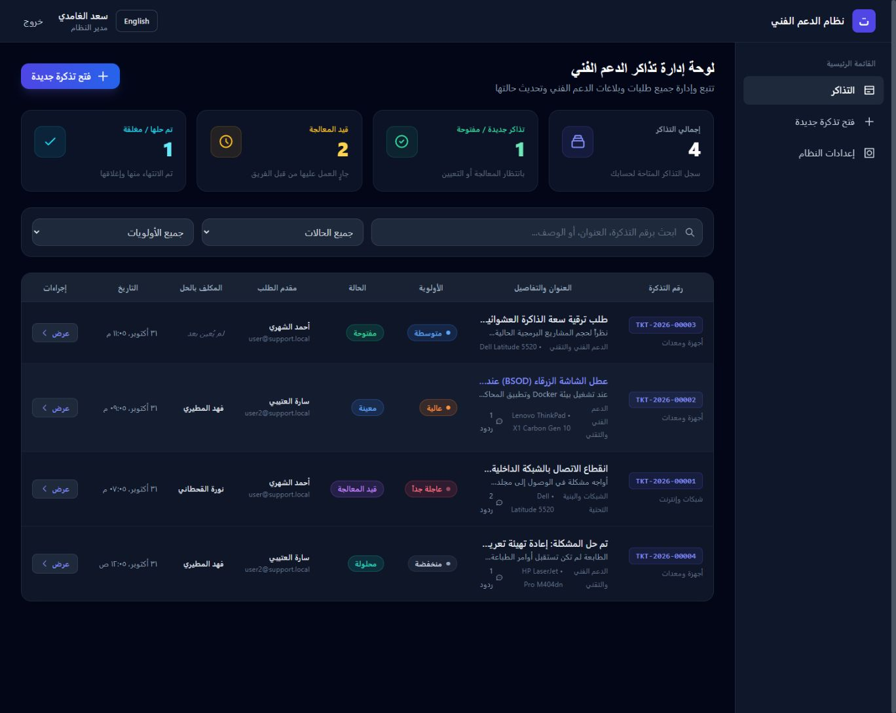
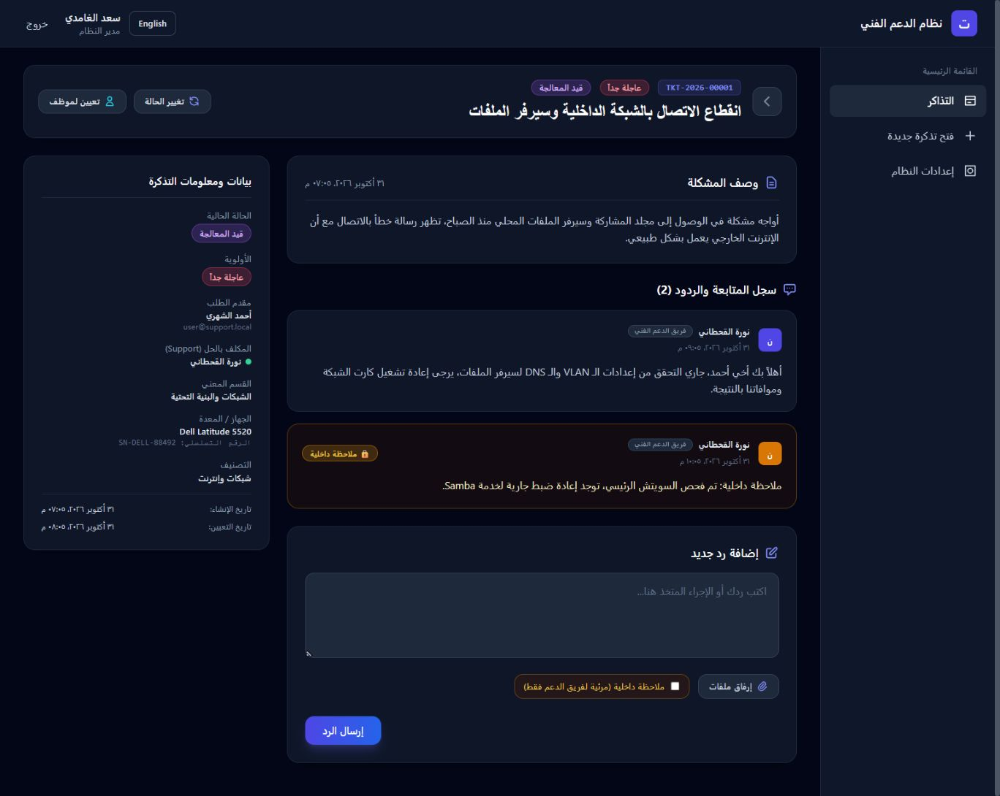
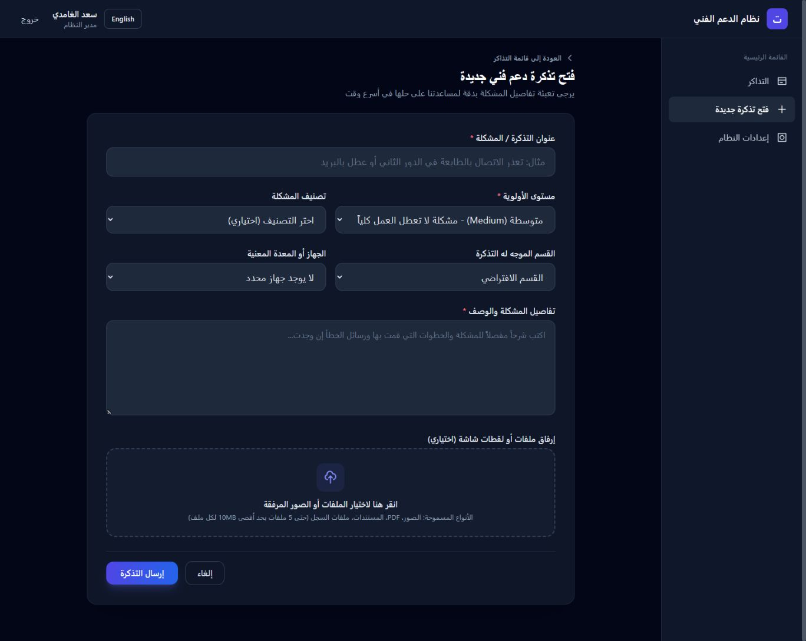
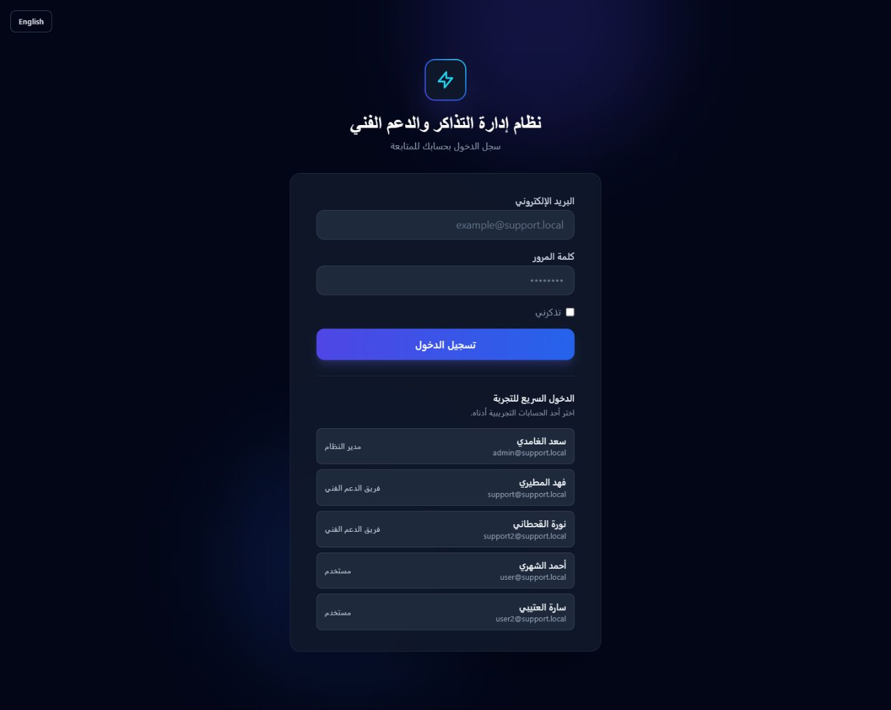

# نظام دعم فني - IT Support Ticketing System

نظام متكامل لإدارة تذاكر الدعم الفني باللغتين العربية والإنجليزية، مع تبديل اتجاه الواجهة تلقائياً بين RTL و LTR.

يمكن تغيير اللغة من زر **English / العربية** في صفحة تسجيل الدخول أو الشريط العلوي بعد الدخول. يُحفظ الاختيار على هذا المتصفح.

## صور الواجهة

الصور التالية مأخوذة من تشغيل محلي فعلي باستخدام بيانات تجريبية مصطنعة.

### لوحة إدارة التذاكر



### تفاصيل التذكرة وسجل الردود



### فتح تذكرة جديدة



### تسجيل الدخول والحسابات التجريبية



## التقنيات المستخدمة

- **Backend:** Laravel 11
- **Frontend:** Vue.js 3 + Inertia.js
- **Styling:** Tailwind CSS (Dark Mode + RTL/LTR)
- **Real-time:** Laravel Reverb (WebSocket)
- **Database:** MySQL

## الميزات الرئيسية

### 1. نظام الصلاحيات (RBAC)
- Admin: صلاحيات كاملة
- Support: صلاحيات الدعم الفني
- User: مستخدم عادي

### 2. إدارة التذاكر
- إنشاء تذاكر جديدة
- تعيين التذاكر للموظفين
- تتبع حالة التذكرة (مفتوحة، معينة، قيد المعالجة، محلولة، مغلقة)
- أولويات متعددة (منخفضة، متوسطة، عالية، عاجلة)

### 3. نظام الردود
- ردود عامة
- ملاحظات داخلية (للدعم الفني فقط)
- رسائل النظام التلقائية

### 4. المرفقات الآمنة
- رفع ملفات مع التذاكر والردود
- تخزين آمن خارج المجلد العام
- التحقق من نوع وحجم الملف
- تحميل آمن مع فحص الصلاحيات

### 5. إشعارات لحظية
- Laravel Reverb للإشعارات الفورية
- تحديث تلقائي عند تغيير حالة التذكرة
- إشعار عند إضافة رد جديد

### 6. تتبع المعدات
- ربط التذكرة بجهاز معين
- تتبع الأجهزة حسب الرقم التسلسلي
- سجل كامل للتذاكر المتعلقة بكل جهاز

## هيكلة قاعدة البيانات

### الجداول الأساسية

1. **roles** - أدوار المستخدمين
2. **departments** - الأقسام
3. **users** - المستخدمون (مع role_id و department_id)
4. **equipment** - المعدات
5. **tickets** - التذاكر
6. **ticket_replies** - الردود
7. **attachments** - المرفقات (polymorphic)

## التثبيت

> الدخول السريع للحسابات التجريبية يعمل فقط في البيئة المحلية عند ضبط
> `APP_ENV=local` و`APP_DEBUG=true` و`DEMO_QUICK_LOGIN=true` في `.env`.
> اترك `DEMO_QUICK_LOGIN=false` في أي بيئة منشورة.

### 1. تثبيت Dependencies

```bash
composer install
npm install
```

### 2. إعداد البيئة

```bash
cp .env.example .env
php artisan key:generate
```

### 3. إعداد قاعدة البيانات

```env
DB_CONNECTION=mysql
DB_HOST=127.0.0.1
DB_PORT=3306
DB_DATABASE=support_system
DB_USERNAME=root
DB_PASSWORD=
```

```bash
php artisan migrate
```

### 4. إعداد Laravel Reverb

```env
BROADCAST_CONNECTION=reverb
REVERB_APP_ID=your-app-id
REVERB_APP_KEY=your-app-key
REVERB_APP_SECRET=your-app-secret
REVERB_HOST=127.0.0.1
REVERB_PORT=8080
REVERB_SCHEME=http
```

```bash
php artisan reverb:start
```

### 5. إنشاء مجلد التخزين الآمن

```bash
mkdir -p storage/app/private/attachments
php artisan storage:link
```

### 6. تشغيل التطبيق

```bash
# Terminal 1: Laravel
php artisan serve

# Terminal 2: Vite
npm run dev

# Terminal 3: Reverb
php artisan reverb:start

# Terminal 4: Queue Worker (optional)
php artisan queue:work
```

## معايير الأمان

### 1. التحقق من المدخلات
- FormRequest للتحقق من جميع المدخلات
- `strip_tags()` لمنع XSS
- قواعد صارمة للملفات المرفوعة

### 2. التفويض
- Policy لكل عملية على التذاكر
- فحص الصلاحيات قبل كل إجراء
- عزل البيانات حسب الصلاحيات

### 3. المرفقات الآمنة
- تخزين في `storage/app/private`
- أسماء ملفات عشوائية (SHA256)
- فحص MIME type
- تحميل عبر Controller مع فحص الصلاحيات
- حد أقصى 10MB للملف الواحد
- 5 ملفات كحد أقصى

### 4. حماية من XSS
- DOMPurify في Vue.js
- Sanitize HTML في Backend
- فقط tags آمنة مسموح بها

## الواجهة الأمامية

### مكونات Vue.js

- **TicketView.vue** - عرض التذكرة مع الردود
- Dark Mode افتراضي
- RTL كامل
- WebSocket للتحديثات اللحظية

### Tailwind CSS

```javascript
// tailwind.config.js
module.exports = {
  content: [
    './resources/**/*.blade.php',
    './resources/**/*.js',
    './resources/**/*.vue',
  ],
  darkMode: 'class',
  theme: {
    extend: {},
  },
}
```

## API Routes

```php
// Tickets
GET    /tickets              // List tickets
GET    /tickets/create       // Create form
POST   /tickets              // Store ticket
GET    /tickets/{id}         // Show ticket
PUT    /tickets/{id}         // Update ticket
DELETE /tickets/{id}         // Delete ticket

// Replies
POST   /tickets/{id}/reply   // Add reply

// Attachments
GET    /attachments/{id}/download  // Secure download
```

## WebSocket Events

```javascript
// Listen to ticket updates
Echo.channel(`ticket.${ticketId}`)
    .listen('.ticket.updated', (e) => {
        // Update UI
    });
```

## الصلاحيات (Policies)

### TicketPolicy Methods

- `viewAny()` - عرض قائمة التذاكر
- `view()` - عرض تذكرة محددة
- `create()` - إنشاء تذكرة
- `update()` - تعديل تذكرة
- `delete()` - حذف تذكرة
- `reply()` - الرد على تذكرة
- `assign()` - تعيين تذكرة
- `changeStatus()` - تغيير الحالة
- `viewInternalNotes()` - عرض الملاحظات الداخلية
- `addInternalNote()` - إضافة ملاحظة داخلية

## البيانات التجريبية (Seeding)

```php
// database/seeders/DatabaseSeeder.php
php artisan db:seed
```

ينشئ:
- 3 أدوار (admin, support, user)
- 3 أقسام
- 10 مستخدمين
- 20 معدة
- 50 تذكرة مع ردود

## الأداء

- Eager loading للعلاقات
- Indexes على الأعمدة المستخدمة في البحث
- Pagination للقوائم
- Queue للعمليات الثقيلة

## الأمان والنسخ الاحتياطي

```bash
# Backup database
mysqldump -u root -p support_system > backup.sql

# Backup attachments
tar -czf attachments-backup.tar.gz storage/app/private/attachments
```

## الترخيص

MIT License
